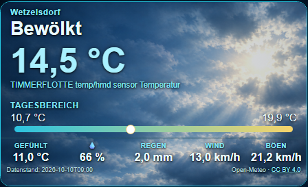
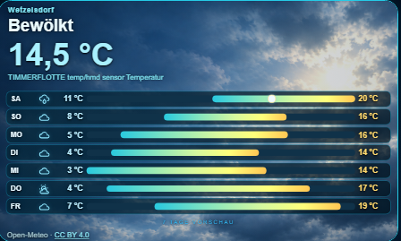

# Frankys_Stuff Weather Card – v0.3.0

<p align="center">
  <a href="https://ko-fi.com/Frankys_Stuff">
    
  </a>
</p>

[](https://hacs.xyz/docs/faq/custom_repositories/)

## Vorschau

### Aktuelles Wetter


### 7-Tage-Vorhersage


## Download

[Weather Card herunterladen](https://github.com/Franz1302/frankys-stuff-weather-card/blob/main/frankys-stuff-weather-card.js)

Die Installationsanleitung findest du weiter unten.

Eigenständige Home-Assistant-Lovelace-Wetterkarte im dunklen HUD-/Glasdesign mit **Tagesansicht**, **7-Tage-Vorschau**, **WebP-Wetterhintergründen** und **visuellem Karteneditor**.

**Release-Status:** v0.3.0 – Veröffentlichungspaket. Die Installation wurde
vom Herausgeber in Home Assistant erfolgreich getestet. Die acht integrierten
WebP-Bilder wurden nach seiner Erklärung mit ChatGPT erstellt und sind
für nichtkommerzielle Nutzung unter CC BY-NC 4.0 freigegeben; der JavaScript-Code
steht unter MIT. Siehe `LICENSE`, `LICENSE_SCOPE.md`, `ARTWORK_LICENSE.md` und `RELEASE_STATUS.md`.

## Voraussetzungen

- Home Assistant mit Lovelace-Dashboard und einem aktuellen Browser mit **Custom Elements**, **Shadow DOM** und **WebP-Unterstützung**.
- Bei Open-Meteo-Direktabruf: Internetverbindung des **Browsers**, Freigabe ausgehender HTTPS-Anfragen und gültige Koordinaten in `zone.home`.
- Bei Nutzung einer bestehenden `weather.*`-Entität: diese muss für die 7-Tage-Ansicht passende Forecast-Daten bereitstellen. `sun.sun` ist der Standard für die Tag-/Nachterkennung.
- **Kein HACS und keine zusätzlichen JavaScript-Bibliotheken erforderlich.** Wettergrafiken sind bereits als acht Base64-WebPs in der JS enthalten.

## Installation

### Installation über HACS als benutzerdefiniertes Repository

**Status (18.10.2026):** Das Repository ist für HACS als benutzerdefiniertes **Dashboard**-Repository vorbereitet. Ein eigener HACS-Installationstest wurde nicht durchgeführt; die manuelle Installation wurde getestet. Die Karte ist **nicht im offiziellen HACS-Katalog gelistet**.

1. In Home Assistant **HACS → ⋮ → Benutzerdefinierte Repositories** öffnen.
2. `https://github.com/Franz1302/frankys-stuff-weather-card` hinzufügen und als Typ **Dashboard** auswählen.
3. Das Repository in HACS öffnen und die Weather Card installieren.
4. Das Dashboard neu laden.

### Manuelle Installation

1. `frankys-stuff-weather-card.js` nach `/config/www/frankys-stuff-weather-card.js` kopieren. Falls `www` neu angelegt wurde, Home Assistant neu starten.
2. Im Home-Assistant-Dashboard unter **Ressourcen** eine Ressource des Typs **JavaScript-Modul** hinzufügen:

   ```text
   /local/frankys-stuff-weather-card.js?v=0.3.0
   ```

3. Dashboard neu laden; nach Versionswechsel ggf. Browsercache umgehen.
4. Karte hinzufügen, YAML-Beispiel verwenden oder den visuellen Editor öffnen.

### Minimalbeispiel – Open-Meteo ohne Wetterentität

```yaml
type: custom:frankys-stuff-weather-card
language: de
source_label: MEIN ORT
size: normal
```

Die Karte verwendet die Koordinaten von `zone.home` und lädt Wetterdaten direkt von Open-Meteo. Dabei werden die Standortkoordinaten an Open-Meteo gesendet; bei fehlender Internetverbindung ist dieser Modus nicht nutzbar.

### Beispiel – vorhandene Home-Assistant-Wetterentität

```yaml
type: custom:frankys-stuff-weather-card
weather_entity: weather.home
sun_entity: sun.sun
source_label: ZUHAUSE
language: de
height: 420
```

`weather.home` ist **ein Platzhalter** und muss durch die echte Entität ersetzt werden. Die Karte nutzt deren Wetterwerte und ruft vorhandene Vorhersagen über die HA-Weather-Forecast-Schnittstelle ab.

### Beispiel – lokaler Temperatursensor zusätzlich

```yaml
type: custom:frankys-stuff-weather-card
weather_entity: weather.home
temperature_entity: sensor.aussentemperatur
humidity_entity: sensor.aussenfeuchte
language: de
size: large
```

`temperature_entity` und `humidity_entity` überschreiben nur die jeweiligen angezeigten Messwerte; alle Entitäten sind Beispiele und keine festen Voraussetzungen.

## Konfigurationsoptionen

| Parameter | Standard | Beschreibung |
| --- | --- | --- |
| `weather_entity` | leer | `weather.*` für HA-Wetterwerte/Vorhersage, oder ein `sensor.*` mit Open-Meteo-kompatiblen `current`/`daily`-Attributen |
| `temperature_entity` | leer | Optionaler `sensor.*` als Temperaturquelle |
| `humidity_entity` | leer | Optionaler `sensor.*` als Feuchtequelle |
| `sun_entity` | `sun.sun` | Sonnenstatus für Tag-/Nachtmotiv |
| `source_label` | `ORT` | Beschriftung im Wetterbereich |
| `language` | `auto` | `auto`, `de` oder `en` (einige Status-/Bereichstexte derzeit noch auf Deutsch) |
| `forecast_model` | `best_match` | `best_match` oder `geosphere_seamless` (nur Open-Meteo-Direktabruf) |
| `refresh_minutes` | `30` | Datenabrufintervall (5–1440 Minuten) im Direktabruf |
| `size` | `normal` | `compact`, `normal` oder `large` |
| `height` | leer | Feste Höhe in Pixeln |
| `min_height` | leer | Minimale Höhe in Pixeln |
| `image_sunny`, `image_clear_night`, `image_partlycloudy`, `image_cloudy`, `image_fog`, `image_rainy`, `image_lightning`, `image_snowy` | leer | Optionale eigene Bildadresse als `/local/...` oder `https://...` |

## Bedienung

- Die **gesamte Kartenfläche** schaltet per Klick/Tippen zwischen Tagesansicht und 7-Tage-Vorschau um.
- Bei Wetterbildwechsel blendet die Karte **eine Sekunde** über und hält dekodierte Bild-Elemente im Speicher, damit nicht unnötig neu geladen wird.
- Eingebettete Hintergründe sind **horizontal gespiegelt**, damit die Beschriftungen lesbar bleiben.
- Für eine 7-Tage-Prognose aus einer HA-`weather.*`-Entität sind deren Forecast-Funktionen erforderlich. Fehlen sie, bleiben die verfügbaren aktuellen Werte sichtbar.

## Fehlerbehebung

- **„Custom element doesn't exist“**: Ressourcenpfad, Modul-Typ und Cache prüfen; Datei muss unter `/config/www` liegen.
- **Keine Wetterdaten im Direktmodus**: `zone.home`-Koordinaten, DNS/Internet im Browser, mögliche Browser-Blockaden (CORS/CSP) und Open-Meteo-Verfügbarkeit prüfen.
- **Keine 7-Tage-Vorhersage**: Prüfen, ob `weather_entity` eine HA-Wetterentität mit Forecast-Funktion oder ein kompatibler Sensor ist.
- **Keine Hintergründe auf sehr alten Geräten**: Browser muss WebP unterstützen. Ältere iOS-/Safari-Versionen unterstützen WebP nicht zuverlässig; auf solchen Geräten ist ein aktuellerer Browser bzw. eine aktualisierte Plattform erforderlich.
- **Neue Version wird nicht angezeigt**: Cache umgehen und die Ressourcenkennung (`?v=...`) aktualisieren.

## Datenquelle, Datenschutz und Lizenz

- Im Direktmodus: **Open-Meteo API** (`https://api.open-meteo.com/`) mit CC BY 4.0 für die Wetterdaten. Die öffentliche kostenlose API ist **nur für nichtkommerzielle Nutzung** und gemäß den Dienstbedingungen zulässig; https://open-meteo.com/en/terms sowie https://open-meteo.com/en/licence.
- Die Karte ist nicht identisch mit dem Open-Meteo-Serverprojekt. Es wird **kein Open-Meteo-Servercode** mitgeliefert.
- **Code:** MIT-Lizenz (`LICENSE`). Sie erlaubt auch kommerzielle Nutzung des Codes, sofern der Lizenzhinweis erhalten bleibt.
- **Acht eingebettete WebP-Motive:** CC BY-NC 4.0 (`ARTWORK_LICENSE.md`) mit Namensnennung **Frankys_Stuff**. Weitergabe und Bearbeitung sind nichtkommerziell möglich; die Bilder sind **nicht MIT-lizenziert**. Für eine kommerzielle Nutzung des Kartenpakets müssen diese Motive durch andere, entsprechend lizenzierte Grafiken ersetzt werden.
- Die Motive wurden laut Herausgeber mit ChatGPT erstellt. Der Lizenzhinweis räumt Nutzungsrechte im rechtlich möglichen Umfang ein und ist **keine Garantie**, dass rein KI-generiertes Material urheberrechtlich exklusiv geschützt ist.

Weitere Hinweise unter `THIRD_PARTY_NOTICES.md`, `QA_REPORT.md` und `RELEASE_STATUS.md`.

**Veröffentlichungsstand:** GitHub-Release **v0.3.0** ist bereits veröffentlicht, und `hacs.json` liegt im Hauptzweig. Die MIT-Lizenz gilt für den Code; die eingebetteten Motive unterliegen zusätzlich `ARTWORK_LICENSE.md` (CC BY-NC 4.0).
